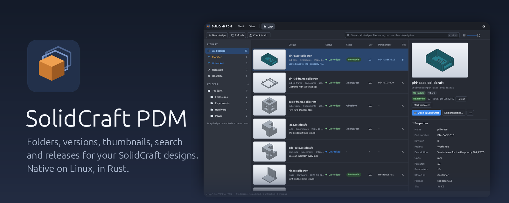
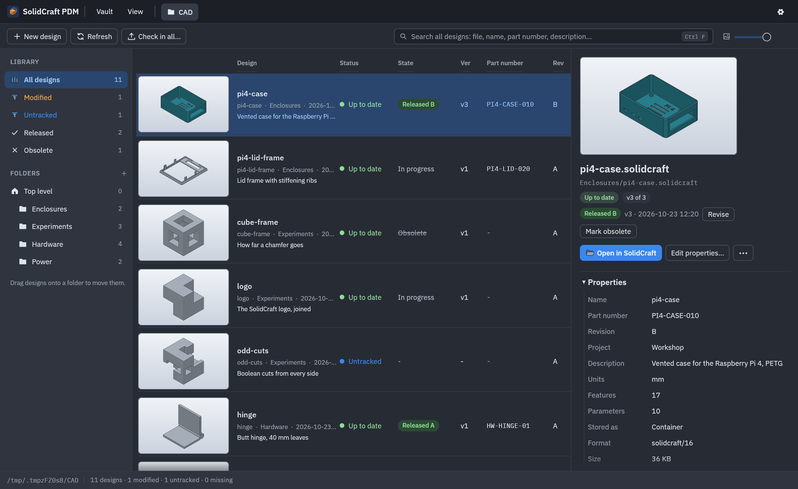
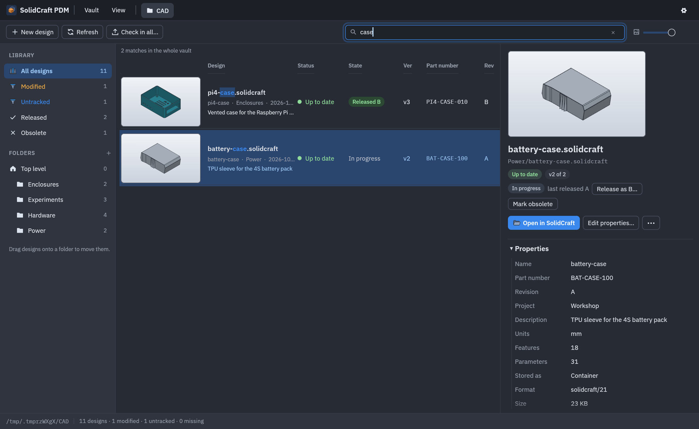
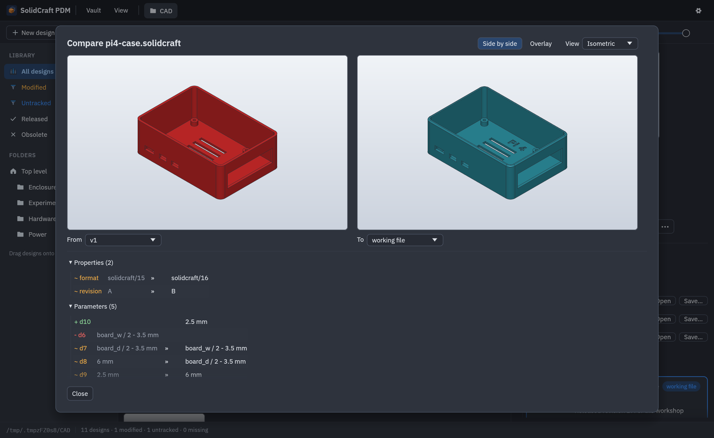
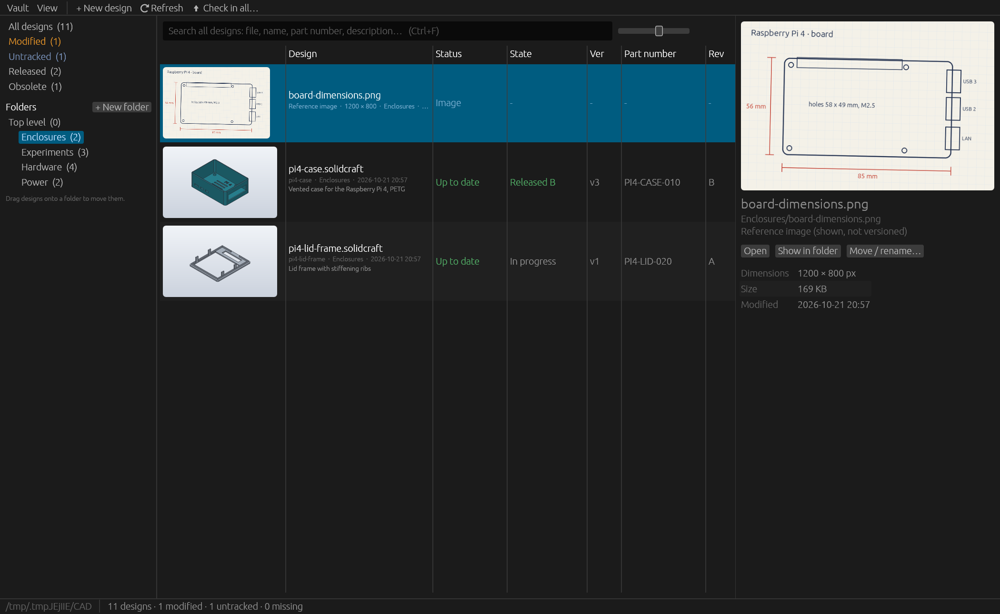

<p align="center">
  
</p>

<p align="center">
  <a href="https://gitlab.com/randomlegend/solidcraft-pdm/-/releases"></a>
  <a href="https://gitlab.com/randomlegend/solidcraft-pdm/-/pipelines"></a>
</p>

**SolidCraft PDM** keeps your [SolidCraft](https://github.com/tangency-labs/solidcraft) designs
in order: browse them by folder with big thumbnails, find anything with a fuzzy search, check in
versions, see what changed, release revisions, and move files without breaking the links between
them. Your designs stay ordinary files in an ordinary folder; SolidCraft opens and saves them as
before. Native on Linux, written in Rust; for one person, or for a small team with the
optional [server](docs/server.md).

## Features



- **Versions without ceremony.** Any folder becomes a vault. Saving in SolidCraft shows up as
  *Modified*; *Check in* records a version with a comment and a thumbnail. Restore any version
  (unsaved work is checked in first, so nothing is lost), save a copy of it, or open it
  read-only.
- **Revisions.** Release a design as A, B, C … (or 01, 02 …): the revision is written into the
  design and the version recorded. Designs are *in progress*, *released* or *obsolete*.
- **Properties.** Part number, description, project and more, edited right in the file, the
  same ones SolidCraft shows under *Design Properties*.



- **Find anything.** The search (Ctrl+F) looks through the whole vault: file names, design names,
  part numbers, descriptions, fuzzy and ranked, with the matching letters highlighted.



- **See what changed** between any two versions: properties, parameters (`height: 24 mm » 32
  mm`), features (added, removed, renamed, suppressed, which settings), components and links.



- **Folders that fit how you work.** Drag designs between folders; links from assemblies to their
  parts are updated. Reference images (PNG, JPEG, WebP) show up next to the designs in their
  folder.
- **Made for SolidCraft.** Double-click opens a design in SolidCraft as installed, also as an
  AppImage; *+ New design* starts one. The interface scales up to 250 % for large screens.
- **Optional team server.** Share vaults with a small team: everyone works in a folder of their
  own, checks designs out (one person at a time) and checks them in; moves, releases and
  properties are changed on the server. See [docs/server.md](docs/server.md).

More in the [guide](docs/guide.md).

## Install

Download the AppImage from the [releases](https://gitlab.com/randomlegend/solidcraft-pdm/-/releases)
(x86_64 Linux, glibc 2.36 or newer), make it executable and start it:

```sh
chmod +x SolidCraft-PDM-*-x86_64.AppImage
./SolidCraft-PDM-*-x86_64.AppImage ~/CAD
```

Point it at the folder with your designs; it offers to make it a vault (a hidden `.pdm` folder,
your files are not changed). *Vault > Settings > Add SolidCraft PDM to the application menu* puts
it into your launcher, with its icon. The AppImage looks for a new release once a day and,
when you agree, replaces itself with it (checked against the release's `SHA256SUMS`) and
restarts; see the [guide](docs/guide.md#updates).

Windows 10 / 11: prepared, built by hand in CI; see [docs/windows.md](docs/windows.md).

The team server runs with Docker (`registry.gitlab.com/randomlegend/solidcraft-pdm/server`,
with a `compose.yml` that adds HTTPS) or as a program; see [docs/server.md](docs/server.md).

## Command line

The same vault from a terminal: `scpdm` (in the AppImage: `SolidCraft-PDM-….AppImage cli …`).

```text
scpdm init [dir]                 make a folder a vault
scpdm status                     untracked / modified / missing designs
scpdm ci <files…> -m "comment"   check in
scpdm log <file>                 versions, newest first
scpdm diff <file> <from> [to]    what changed (versions as 3 or v3, or "working"; to: working file)
scpdm restore <file> <n>         put version n back
scpdm export <file> <n> <out>    save a copy of version n
scpdm mv <from> <to>             move or rename, keeping history and updating links
scpdm release <file> [-m note] [--revision R]   release (revision written into the design)
scpdm revise <file> / obsolete <file> [--undo]  back to work in progress / obsolete
scpdm props <file> [--set key=value]… [--name N] [--check-in]  show or edit design properties
scpdm new <file> [--part-number P] [--description D]   create an empty design as v1
scpdm scheme [letters|numbers]   the vault's revision scheme
scpdm relink <missing> <to>      attach history to a file moved outside the PDM
scpdm ls [dir] / info <file> / thumb <file> <out.png>
scpdm remote …                   a workspace of a server vault (docs/server.md)
```

## Building

Rust 1.93 or newer:

```sh
cargo run --release -p scpdm-gui -- ~/CAD     # the desktop app
cargo run --release -p scpdm -- --help        # the command line
cargo run --release -p scpdm-server -- --help # the team server
cargo test --workspace                        # the tests (the GUI tests drive the real window)
packaging/linux/build-appimage.sh             # dist/SolidCraft-PDM-<version>-x86_64.AppImage
```

| Path | What |
|---|---|
| `crates/scformat` | SolidCraft design files (container or plain JSON): properties, links, thumbnail; exact edits; comparing versions |
| `crates/vault` | The vault: SQLite index (`.pdm/vault.db`), content-addressed store (`.pdm/objects/`), lifecycle |
| `crates/protocol` | The server's HTTP API: JSON types shared by server and client |
| `crates/remote` | Client: server connection and workspaces (a local folder of a server vault) |
| `apps/scpdm` | Command line |
| `apps/scpdm-server` | Team server (axum): users, sessions, access, check-out locks |
| `apps/scpdm-gui` | Desktop app (egui), binary `solidcraft-pdm` |
| `packaging/` | AppImage, Windows installer, server Docker image and compose file, icons (`make-icons.py`; the source is `assets/solidcraft-pdm.svg`) |
| `docs/` | [Guide](docs/guide.md), [Server](docs/server.md), [Windows](docs/windows.md), README images (`make-screenshots.sh`) |

## Releasing

1. Set the version in `Cargo.toml` (`[workspace.package]`) and add its section to
   [CHANGELOG.md](CHANGELOG.md) (`## 0.2.0 — date`).
2. Commit, then tag and push: `git tag v0.2.0 && git push origin v0.2.0`.

CI then builds the AppImage and the server (program and Docker image), and publishes a
release with the changelog section as its notes and the files with their `SHA256SUMS`. A tag
whose version does not match `Cargo.toml`, or without a changelog section, fails the pipeline
instead.

## Design decisions

- **Own reader, no dependency on SolidCraft's crates.** They need a newer Rust, pull in the
  geometry kernel, and would tie the PDM to one SolidCraft release. The parts a PDM needs are
  documented and stable (`docs/design-container.md` and `docs/book/src/guide/files.md` in
  SolidCraft's repository): the container's `document.json` and `cache/thumbnail.png`, the
  `metadata` design properties, and `links` between designs.
- **Careful writes to design files**, only for link updates, properties and releases: the other
  entries of a container are copied byte for byte, key order and every number survive exactly,
  writes are atomic, and an edit that changes nothing leaves the file alone.
  `crates/scformat/tests/solidcraft_cli.rs` has SolidCraft itself re-save what the PDM wrote.
- **Versions are whole-file copies, stored once per distinct content** (SHA-256) and verified on
  read.
- **Standalone first, server optional.** A vault on your own machine needs nothing else. The
  server keeps each shared vault as an ordinary vault and adds users, check-out locks and an
  HTTP API; people work in local workspaces (not temporary copies), so links between designs
  keep working and saved work is never lost. Locking instead of merging, since CAD files
  cannot be merged.

## Credits

The test fixtures and the designs in the screenshots are SolidCraft's own sample designs
(MIT/Apache-2.0, from [tangency-labs/solidcraft](https://github.com/tangency-labs/solidcraft));
their thumbnails were rendered by SolidCraft.
