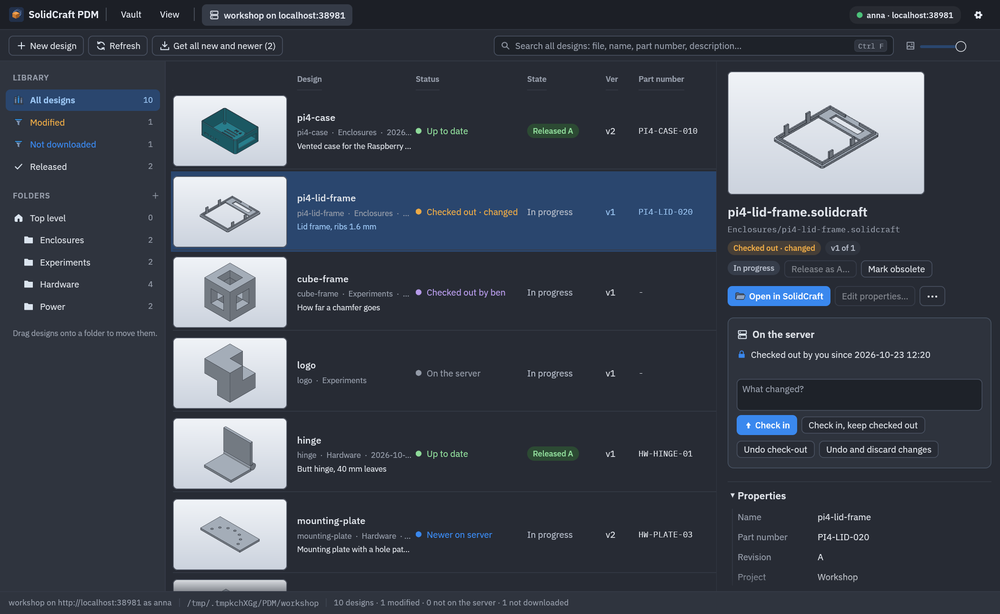
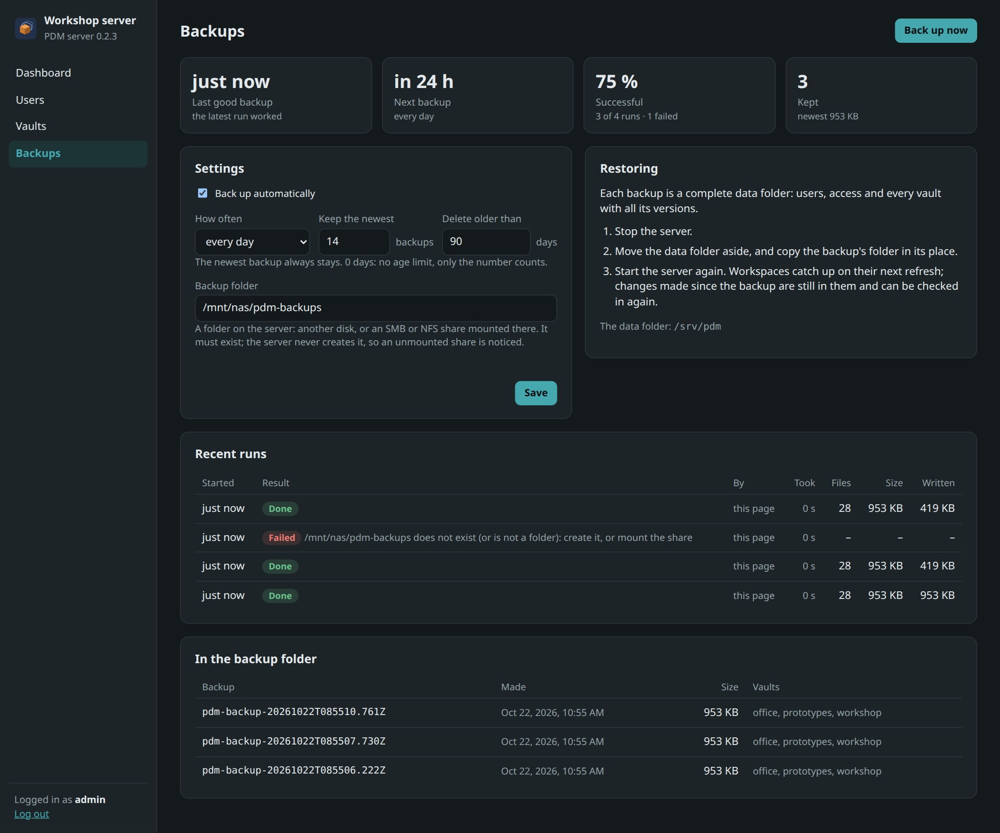
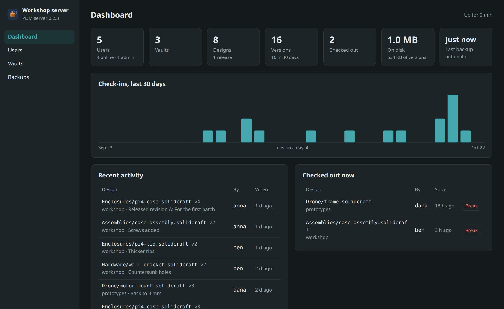
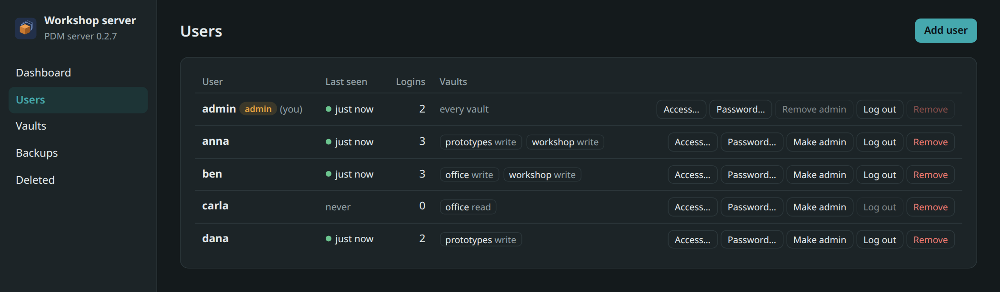

# The team server

SolidCraft PDM works on its own, for one person. For a small team, a **server** can hold
shared vaults: everyone works in a folder of their own (a *workspace*), and a design is
changed by one person at a time, who has it *checked out*.



New in 0.2. The server runs on Linux, with Docker or as a program of its own; a Windows build
comes later. It is meant for a trusted team on one network or a VPN.

## How it works

- The server keeps each vault as an ordinary vault (the same history, thumbnails, releases and
  links as on your own machine). Its files are always the latest versions.
- Your **workspace** is a normal folder with the vault's folder structure, say `~/PDM/workshop`.
  SolidCraft opens and saves the designs there, so links between assemblies and parts work as
  usual. A hidden `.pdm-workspace` folder records which version of each file you fetched, and
  your login.
- **Get** fetches a design (or everything new and newer). Designs you have not checked out are
  read-only, as a reminder.
- **Check out** locks a design on the server: nobody else can check it in, release it or change
  its properties until you check it in or undo the check-out. CAD files cannot be merged, so
  this is the only way two people do not overwrite each other's work.
- **Check in** uploads your saved file as the next version, and gives the check-out back (or
  keeps it, *Check in, keep checked out*). It is refused if the server has a newer version
  than the one you started from.
- **Nothing local is overwritten.** A design you changed without checking it out shows as
  *Changed, not checked out*. If someone else checks in meanwhile, it shows as *Conflict*. Get
  refuses to replace it; check it out, or keep a copy and get the latest.
- **Moves and renames** run on the server, which updates the links in the designs that point to
  the moved file. That needs those designs to be checked in. Other workspaces follow the move
  on their next refresh.
- **Releases, revisions, obsolete, properties, folders and reference images** are changed on
  the server, so everyone sees the same state.

Statuses in the app: *On the server* (not fetched), *Up to date*, *Newer on server*, *Checked
out*, *Checked out · changed*, *Checked out by anna*, *Changed, not checked out*, *Conflict*,
*Not on the server* (a new file of yours: *Add to the server*), *Removed on the server*.

### A vault for one person: check-out optional

Check-outs keep two people from changing a design at once. For a vault only you use (on a
server so your designs are backed up and reachable from several computers) they are just an
extra step, and can be switched off per vault: on the administration page under *Vaults*,
*Check-out: optional* (or `scpdm-server vault checkout NAME optional`). Then:

- files in workspaces are not read-only, and a design you saved shows as *Changed*, with a
  *Check in* button: no check-out first;
- with *Check in automatically* in the app's settings, every save goes up as the next version
  by itself, a few seconds later;
- the safety rules stay: a change made on an old version is still refused (*Conflict*), and
  anyone may still check a design out, which keeps the others out as before.

## With Docker

Each release has an image, `registry.gitlab.com/randomlegend/solidcraft-pdm/server` (tags
`latest` and the version, e.g. `0.2.0`). With
[packaging/docker/compose.yml](../packaging/docker/compose.yml) in a folder of its own:

```sh
docker compose up -d
docker compose exec pdm scpdm-server user add root --admin    # asks for the password
docker compose exec pdm scpdm-server user add anna
docker compose exec pdm scpdm-server vault add workshop
docker compose exec pdm scpdm-server grant anna workshop write
```

The server listens on port 7380 (`PDM_PORT` changes it); the app connects to
`http://<this machine>:7380`. Users and vaults are in the volume `pdm-data` (mounted at
`/data`); [backups](#backups) go to the volume `pdm-backups` (`/backups`), daily from the
start. Users and vaults can be added while the server runs. Settings, in the environment or a
`.env` file next to `compose.yml`: `PDM_NAME` (the name the app shows), `PDM_PORT`,
`PDM_VERSION` (an image tag instead of `latest`), `PDM_BACKUPS` (a folder for the backups,
instead of the volume). `docker compose pull && docker compose up -d` updates the server.

**HTTPS with Caddy:** for a server reachable by a name (it needs ports 80 and 443 for its
certificate from Let's Encrypt):

```sh
PDM_DOMAIN=pdm.example.com docker compose --profile https up -d
```

The app then connects to `https://pdm.example.com`. Port 7380 stays open for plain HTTP;
remove its `ports` entry to only allow HTTPS.

Without `compose.yml`:
`docker run -d -p 7380:7380 -v pdm-data:/data registry.gitlab.com/randomlegend/solidcraft-pdm/server`.
The image builds from the project folder with
`docker build -f packaging/docker/Dockerfile -t solidcraft-pdm-server .`.

## As a program

Each release has `scpdm-server-<version>-x86_64-linux` (glibc 2.36 or newer), or build it
(Rust 1.93 or newer):

```sh
cargo build --release -p scpdm-server     # target/release/scpdm-server
```

Set it up with a data folder (`--data DIR`, or `$SCPDM_SERVER_DATA`; default
`./pdm-server-data`):

```sh
export SCPDM_SERVER_DATA=/srv/pdm
scpdm-server user add anna              # asks for the password
scpdm-server user add ben
scpdm-server user add root --admin      # every vault; may break others' check-outs
scpdm-server vault add workshop
scpdm-server grant anna workshop write  # read | write | admin
scpdm-server grant ben workshop write
scpdm-server serve --listen 0.0.0.0:7380 --name "Workshop server"
```

`user password NAME`, `user remove NAME`, `user list`, `vault list` and `revoke USER VAULT`
manage them later; `--password-stdin` reads a password from standard input, for scripts. The
settings of `serve` can also come from `$SCPDM_SERVER_LISTEN` and `$SCPDM_SERVER_NAME`.

The data folder holds `server.db` (users, sessions, access) and `vaults/<name>/`, one vault
each; for its backups see [Backups](#backups). Logins last 30 days; passwords are stored as Argon2 hashes, sessions as hashes of their
tokens.

**HTTPS:** the server speaks plain HTTP. On your own network or a VPN that is fine; otherwise
put a reverse proxy with TLS in front of it (for example Caddy:
`caddy reverse-proxy --from pdm.example.com --to localhost:7380`). The app warns when a
password would travel over `http://` to another machine.

## Backups

The server backs itself up: users, access and every vault with all its versions, into another
folder, on a schedule. Set it up on the administration page under *Backups*: the folder, how
often (every hour to every week; daily by default), how many backups to keep and, if you like,
for how many days at most. *Back up now* runs one at once. The page also shows the last good
backup, when the next one is due, how many runs succeeded and failed (and why), and the
backups in the folder.



**Where to:** another disk, or a network share mounted on the server (SMB / CIFS, NFS):

- **As a program:** start it with `--backup-dir /mnt/nas/pdm` (or `SCPDM_BACKUP_DIR`); then
  the folder is fixed and backups are on from the start. Without it, the folder is set on the
  page. Mount the share with your system as usual (`/etc/fstab`); the server writes as the user
  it runs as, so that user must be able to write there (for SMB: `uid=` in the mount options).
- **With Docker:** backups go to `/backups` in the container: the volume `pdm-backups` in
  `compose.yml`, or a folder of your choice with `PDM_BACKUPS=/mnt/nas/pdm`. The server runs
  as user id 7380: set `PUID` and `PGID` to the folder's owner (`ls -ln` shows the numbers,
  for example `PUID=1000 PGID=1000`), or give 7380 write access (`chown 7380 /mnt/nas/pdm`;
  on an NFS share with root squashing, on the NFS server). Changing `PUID` also hands the data
  volume to that user. `compose.yml` also shows how to make the volume
  an SMB or NFS share directly.

The page warns when the folder is on the same disk as the data (a failing disk would take both).
The server never creates the backup folder itself: if a share is not mounted, its mount point
is missing or empty and the backup fails (and says so) instead of filling the server's own
disk. Make the folder once, on the mounted share.

**What a backup is:** a folder `pdm-backup-<date and time, UTC>` with a complete data folder
inside: `server.db`, `vaults/<name>/` and `backup.json` (when, which vaults, how big). It is
consistent: each vault is held for the moment its database and working files are copied, so
no check-in is caught half-way, and the databases are copied with SQLite's own backup, first
to the server's disk and only then to the share (a database is never opened on the share).
Version files, which never change, are shared with the previous backup as hard links where the
folder allows it (local disks, NFS, many SMB servers), so a backup of a large vault that barely
changed takes little room and time; otherwise they are copied. A backup is written as
`.partial-…` and only renamed when complete; old backups beyond what you keep are deleted, but
only the server's own `pdm-backup-…` folders, and never the newest.

From a script, `scpdm-server backup` makes a backup at once (with `--data` and `--backup-dir`
as for `serve`). While the server runs, prefer the page or the schedule: they hold each vault
while copying it.

**Restoring:** stop the server, move the data folder aside, copy a backup folder in its place
(`cp -a /mnt/nas/pdm/pdm-backup-20261021T021500.000Z /srv/pdm`), start the server. Workspaces
catch up on their next refresh; changes made since the backup are still in them and can be
checked in again. A single vault can be restored the same way: its `vaults/<name>` folder.

## The administration page



A browser at the server's address (`http://server:7380`, or the HTTPS name) opens its
administration page. Administrators log in there with their user name and password; other
users cannot.

- **Dashboard:** users (and who is online), vaults, designs, versions, what is checked out,
  disk use; check-ins of the last 30 days; recent activity. A check-out can be broken there
  (*Break*): for a design someone left checked out. Their changes stay in their workspace.
- **Users:** add users; set a password (which ends their logins); make or remove
  administrators; access per vault (no access, read, read and change, administer); log a user
  out everywhere; remove a user. Not yourself: your own administrator rights and account stay.
- **Vaults:** each vault's numbers, and new vaults.
- **Backups:** see [Backups](#backups).



The command line (`scpdm-server user …`, `vault …`, `grant …`) still works alongside; the first
administrator comes from there (`user add root --admin`).

The page is built into the server (no files to install, nothing loaded from the internet). Its
login is a cookie for this server only (`HttpOnly`, `SameSite=Strict`, `Secure` behind HTTPS);
changes are only accepted from the page itself.

## In the app

*Vault > Connect to a server…*: the address (`http://server:7380`), your user name and
password. Pick a vault and the folder for its workspace (`~/PDM/<vault>` by default), then
*Open the vault*. Next time, open the workspace folder like any vault; the status bar shows
the server and your user. If the login has expired, the app asks for your password again;
without a connection the status bar says *Offline* and why.

The details panel has *Get*, *Check out*, *Check in* (with a comment), *Undo check-out* and
*Undo and discard changes*. The toolbar's *Get all new and newer* fetches everything that
changed.

## On the command line

```text
scpdm remote vaults <url> <user>                 the vaults you may use
scpdm remote join <url> <user> <vault> <dir>     make a folder a workspace
scpdm remote status                              designs and how they relate to the server
scpdm remote get <files…> | --all                fetch the latest versions
scpdm remote checkout <file>                     check out
scpdm remote ci <file> -m "comment" [--keep]     check in (--keep: stay checked out)
scpdm remote undo <file> [--discard]             give the check-out back
scpdm remote add <file> -m "comment"             put a new design onto the server
scpdm remote mv <from> <to>                      move or rename (links are updated)
scpdm remote release <file> --revision R [-m note]   release
scpdm remote log <file>                          versions on the server
scpdm remote login                               log in again
```

They work inside a workspace. The password is asked for, or read from `$SCPDM_PASSWORD`.
